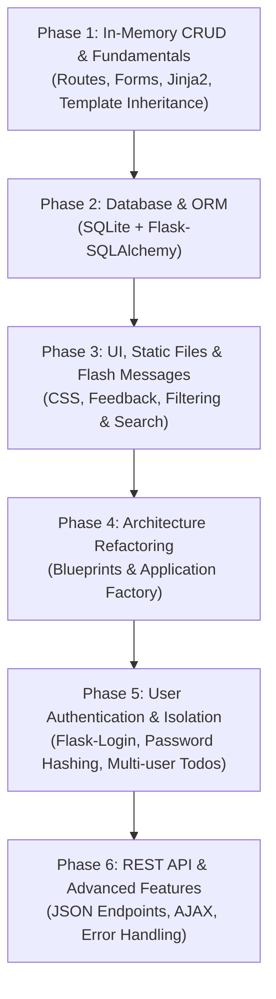

# Flask Todo App: Learning & Implementation Roadmap

Is plan ka main maqsad sirf Todo app banana nahi, balki **Flask framework ke core concepts ko practically master karna** hai. Har phase ek naye concept ko introduce karega taake step-by-step solid foundation ban sake.

---

## 🗺️ Phases Overview



---

## 📌 Phase-by-Phase Breakdown

### Phase 1: Core Fundamentals & In-Memory CRUD
**Goal:** Flask ke basic building blocks (Routing, HTTP methods, Request handling, Templates) samajhna.

- **Concepts Covered:**
  - `@app.route` with `methods=["GET", "POST"]`
  - Reading form data using `request.form`
  - URL generation via `url_for()`
  - Jinja2 Template Inheritance (`base.html` + `block content`)
  - Redirects using `redirect()`
- **Features to Build:**
  - Create `base.html` layout
  - Add Todo form
  - List existing Todos (stored in a temporary Python `list`/`dict`)
  - Mark todo as completed / toggle status
  - Delete todo item
- **Outcome:** Working CRUD app without database persistence.

---

### Phase 2: Database Persistence with Flask-SQLAlchemy
**Goal:** State persistence aur Relational Database ORM ko Flask ke saath integrate karna.

- **Concepts Covered:**
  - `Flask-SQLAlchemy` setup & SQLite config
  - Application Context (`with app.app_context(): db.create_all()`)
  - Model definition (`db.Model`, columns: `id`, `title`, `description`, `is_done`, `created_at`)
  - ORM Queries: `db.session.add()`, `db.session.commit()`, `db.session.delete()`, `Todo.query.all()`, `Todo.query.get_or_404()`
- **Features to Build:**
  - Persistent SQLite database (`todos.db`)
  - Migration from in-memory list to database records
  - Edit/Update todo functionality
- **Outcome:** Data restart ke baad bhi save rahega.

---

### Phase 3: Flash Messages, Static Assets & UI Polish
**Goal:** User experience aur clean frontend styling add karna, along with search and filters.

- **Concepts Covered:**
  - Serving static files (`static/css/style.css`, `url_for('static', ...)`)
  - Flask session-based notification system (`flash()`, `get_flashed_messages()`)
  - Query parameters handling (`request.args.get()`)
- **Features to Build:**
  - Modern, responsive styling (glassmorphism/clean dark mode)
  - Success/Error alerts (e.g., "Todo added successfully!", "Title cannot be empty!")
  - Filters: *All*, *Pending*, *Completed*
  - Keyword search bar
- **Outcome:** Clean, user-friendly and responsive UI with instant feedback.

---

### Phase 4: Production Architecture (Application Factory & Blueprints)
**Goal:** Single-file `app.py` ko modular, scalable structure mein convert karna.

- **Concepts Covered:**
  - Application Factory pattern (`create_app()`)
  - Modular routing with `Blueprint`
  - Configuration classes (`config.py`)
  - Decoupling extensions (`extensions.py`)
- **Directory Structure Target:**
  ```text
  practice-app/
  ├── app/
  │   ├── __init__.py          # create_app()
  │   ├── extensions.py        # db instance
  │   ├── models/
  │   │   └── todo.py
  │   ├── routes/
  │   │   ├── main.py
  │   │   └── todos.py
  │   ├── static/
  │   └── templates/
  ├── config.py
  └── run.py
  ```
- **Outcome:** Industry-standard Flask project architecture.

---

### Phase 5: Authentication & Multi-User Support (Flask-Login)
**Goal:** Har user ke liye private todo list banana aur security best practices sikhna.

- **Concepts Covered:**
  - Password hashing with `werkzeug.security` (`generate_password_hash`, `check_password_hash`)
  - User session management with `Flask-Login` (`login_user`, `logout_user`, `current_user`, `@login_required`)
  - SQLAlchemy Relationships (One-to-Many: `User` -> `Todos`)
- **Features to Build:**
  - User Registration (`/register`)
  - User Login (`/login`) & Logout (`/logout`)
  - User-specific Todo lists (ek user doosre ka todo nahi dekh sakta)
- **Outcome:** Secure, multi-tenant todo web application.

---

### Phase 6: REST API & AJAX Enhancements (Bonus / Polish)
**Goal:** Modern web APIs and asynchronous front-end interaction.

- **Concepts Covered:**
  - Returning JSON with `jsonify`
  - RESTful API route conventions (`/api/todos`)
  - JavaScript `fetch()` calls for toggling todo status without page reloads
- **Outcome:** Full-stack hybrid web app (HTML templates + REST API).

---

## 🚀 Execution Strategy

Hum **ek waqt par ek hi phase** par focus karenge:
1. Har phase shuru karne se pehle uske theoretical concept ka brief overview.
2. Code implementation step-by-step.
3. Verification & testing taake aap output browser mein test kar sakein.
4. Next phase par move karna jab aap completely satisfied hon.
